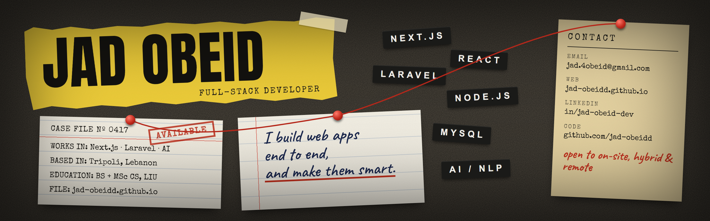
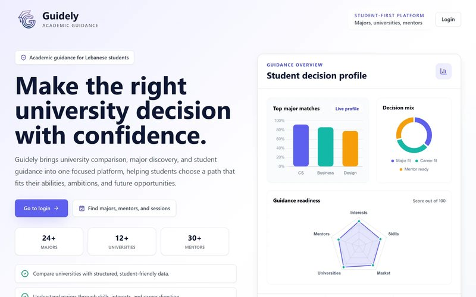
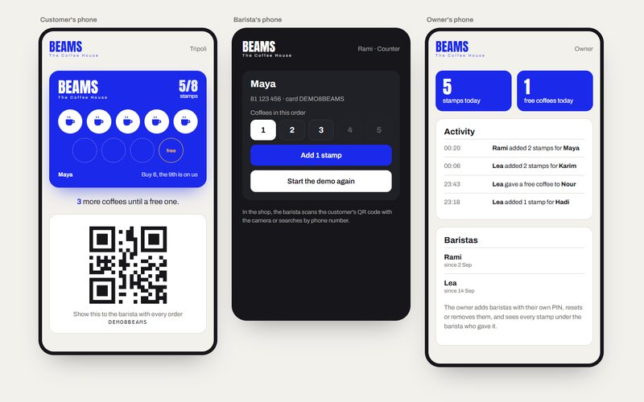
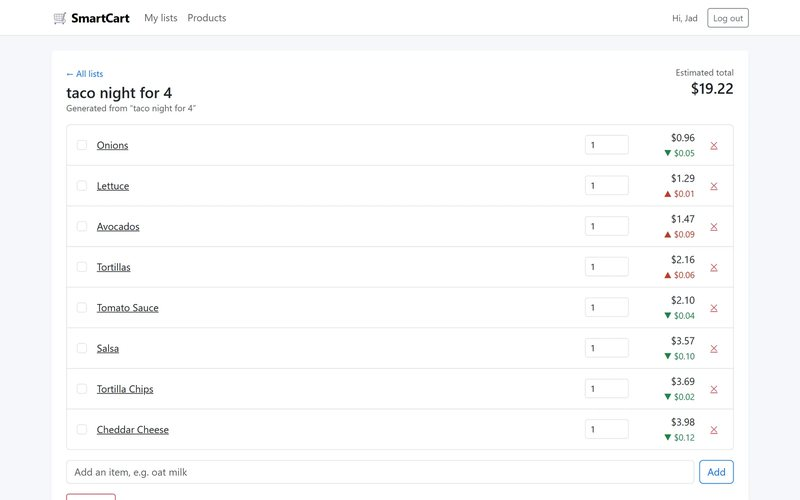
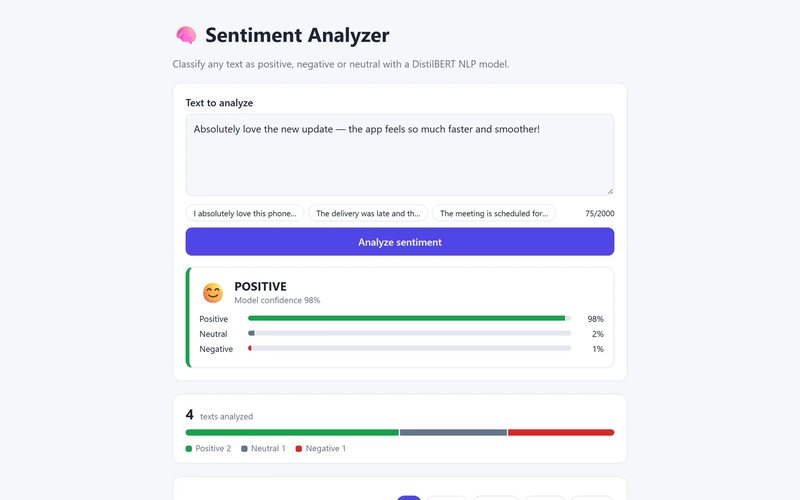
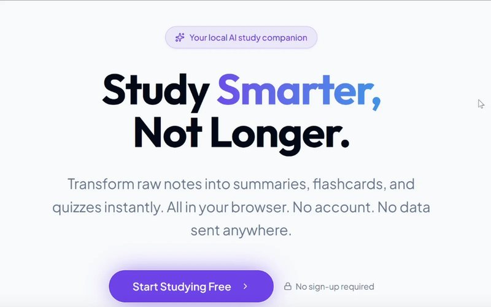
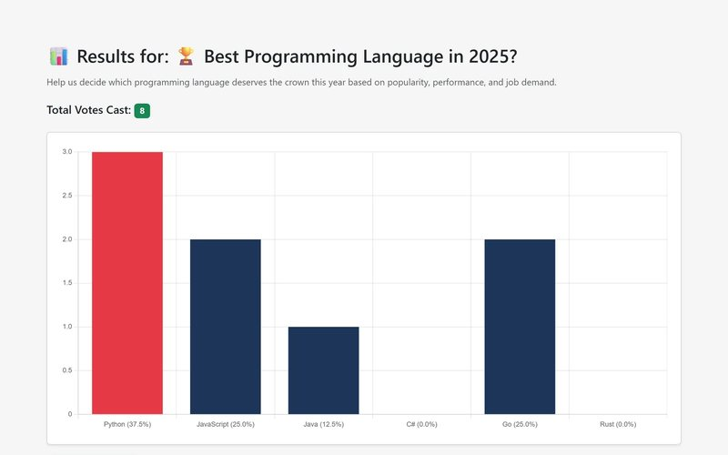

I'm a full-stack developer in Tripoli, Lebanon. I build web apps end to end: the database schema, the REST API, and the Next.js or React front end on top, and lately the AI features inside them. I have a BS in Computer Science from LIU (2025) and I'm doing my MSc there now.

**Portfolio:** [jad-obeidd.github.io](https://jad-obeidd.github.io) &nbsp;·&nbsp; **Email:** [jad.4obeid@gmail.com](mailto:jad.4obeid@gmail.com) &nbsp;·&nbsp; **LinkedIn:** [in/jad-obeid-dev](https://www.linkedin.com/in/jad-obeid-dev)

## Selected work

<table>
  <tr>
    <td width="50%" valign="top">
      
      <h3><a href="https://github.com/hadi-chebbo/Guidely">Guidely</a> team project</h3>
      
University-major guidance platform for Lebanese students, shipped by 7 people in 37 days. I led the frontend: design system, components, admin panel.

      
Next.js 14 · Tailwind CSS · React Query · Laravel 11 · MySQL My PRs: <a href="https://github.com/hadi-chebbo/Guidely/pull/26">majors page</a>, <a href="https://github.com/hadi-chebbo/Guidely/pull/43">search</a>, <a href="https://github.com/hadi-chebbo/Guidely/pull/47">pagination</a>, <a href="https://github.com/hadi-chebbo/Guidely/pull/83">quiz flow</a>

    </td>
    <td width="50%" valign="top">
      
      <h3><a href="https://beams-card-demo.vercel.app/demo">Beams Coffee Card</a> client build</h3>
      
Digital stamp card for Beams Specialty Coffee in Tripoli: buy 8, the 9th is free. Customers keep a QR card on their phone, each barista stamps it from their own PIN account, and the owner sees every stamp in an activity log.

      
Next.js 15 · React 19 · TypeScript · Supabase · html5-qrcode · Vitest <a href="https://beams-card-demo.vercel.app/demo">Live demo</a> · <a href="https://jad-obeidd.github.io/work/beams-coffee-card/">Case study</a>

    </td>
  </tr>
  <tr>
    <td width="50%" valign="top">
      
      <h3><a href="https://github.com/jad-obeidd/smartcart">SmartCart</a></h3>
      
AI shopping assistant. Type <i>"taco night for 4"</i> and get a priced shopping list; search with <i>"healthy snacks under $5"</i>; watch prices update live over Server-Sent Events.

      
React · Node.js · Express · MongoDB · OpenAI API · JWT <a href="https://jad-obeidd.github.io/smartcart/">Live demo</a>

    </td>
    <td width="50%" valign="top">
      
      <h3><a href="https://github.com/jad-obeidd/sentiment-analyzer">Sentiment Analyzer</a></h3>
      
Classifies text as positive, neutral or negative with a multilingual DistilBERT model, with a confidence threshold so plain facts don't read as "positive". History and stats in SQLite, tested with pytest.

      
Svelte · Flask · Hugging Face Transformers · SQLite

    </td>
  </tr>
  <tr>
    <td width="50%" valign="top">
      
      <h3><a href="https://try.ka.nz/ai/jadobeid">SkillForge AI</a> hackathon, rated Gold</h3>
      
Turns study notes into summaries, flashcards, quizzes and study roadmaps. Built at the Kanz AI Training Hackathon 2026, part of a Guinness World Records event.

      
React · TypeScript · Vite · Tailwind · Generative AI <a href="https://jad-obeidd.github.io/work/skillforge-ai/">Case study</a>

    </td>
    <td width="50%" valign="top">
      
      <h3><a href="https://github.com/jad-obeidd/VoteVision">VoteVision</a></h3>
      
Online voting platform: elections, candidate lists, public polls, live result charts and duplicate-vote prevention.

      
PHP · MySQL · JavaScript · Chart.js

    </td>
  </tr>
  <tr>
    <td colspan="2" valign="top">
      <h3>Smaller builds</h3>
      
<a href="https://github.com/jad-obeidd/synent-task6-githubapi-jadobeid">GitHub Profile Finder</a> (<a href="https://jad-obeidd.github.io/synent-task6-githubapi-jadobeid/">live</a>): search any user through the GitHub REST API.

      
<a href="https://github.com/jad-obeidd/synent-task5-todoapp-jadobeid">Smart Task Manager</a> (<a href="https://jad-obeidd.github.io/synent-task5-todoapp-jadobeid/">live</a>): to-do app with priorities, filters and local storage.

      
Both built during my Synent Technologies internship. HTML · CSS · JavaScript

      
<a href="https://github.com/jad-obeidd/jad-obeidd.github.io">This portfolio</a>: Next.js static export with GSAP.

    </td>
  </tr>
</table>

## Where I've worked

| When | Role | Where |
| --- | --- | --- |
| Oct 2026 – now | Freelance web developer: bilingual (EN/AR) websites with WhatsApp ordering for restaurants, cafés and salons | Lebanon |
| Aug – Sep 2026 | Web/Application Developer Intern | Universal Phoenix Group, remote |
| Apr – May 2026 | Frontend Team Lead, Guidely | TechTalks internship program, remote |
| Apr – Jun 2025 | WordPress Developer Intern | InternGrub |
| Feb – Mar 2025 | Database Engineer Intern | M365Connect |
| Feb – Aug 2024 | Web Developer Intern | CodiTech Solutions |

Now: Samsung Innovation Campus AI course (Levant 2026) and my MSc at LIU.

## What I work with

**Front end:** TypeScript, JavaScript, React, Next.js, Svelte, Tailwind CSS, GSAP  
**Back end:** Node.js, Express, Laravel, PHP, Flask, REST APIs, JWT  
**Data and AI:** MySQL, PostgreSQL, MongoDB, SQLite, OpenAI API, Hugging Face Transformers  
**Tools:** Git, Docker, Vercel, WordPress

Open to full-stack and AI-focused developer roles, on-site in Lebanon, hybrid or remote.
